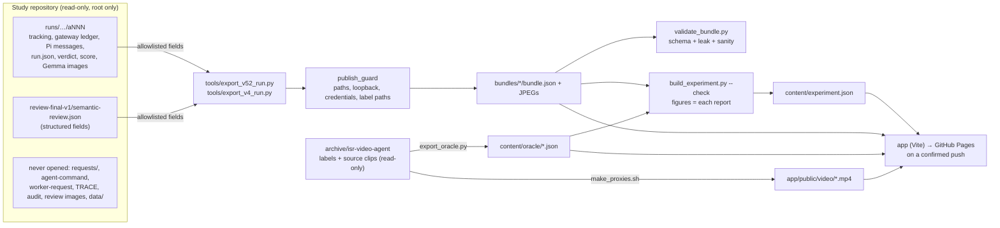

# ISR Video Agent

**Live: https://chungenyu6.github.io/isr-video-agent/**

A replay site for a video system that answers a traffic question about a fixed
camera clip:

> How many vehicles, if any, move opposite to the prevailing nearby traffic in the
> same roadway area? List their colours, and state if the total count remains uncertain.

Two versions of the system are on the site.

| | V5.2 (current) | V4.2 (previous) |
|---|---|---|
| Design | Program-first. The host tracks every vehicle, joins broken tracks into vehicle records, applies a fixed traffic rule, asks Gemma only for each candidate's colour, and writes the answer. When a doubt could change the answer, the program opens a case and Pi + Nemotron investigate it with five tools. | A Nemotron agent in a sandbox reads track facts as text, picks what Gemma should look at through six tools, and writes the answer. |
| Measured | 12 clips × two wordings of the question × two passes = 48 attempts | 6 clips, one attempt each |
| Right count | 48/48 | 3/6 |
| Colours supported by the frames | 48/48 (8 say only “white” and leave out visible purple) | 1/6 (count and colours) |
| Exact colour strings | 28/48 | – |
| `count_complete` true | 8/48 (the two empty r2 scenes) | 0/6 complete |
| Agent | started in 4/48 attempts (one clip), 68 Nemotron calls, every case unresolved | 98 Nemotron calls, every step |
| Promoted | no | no |

V5.2 was also measured in a **controlled diagnostic**: seven saved-state
scenarios, each run without follow-up, with a fixed scripted check, and with Pi.
Pi's case result was right in 1/6 and it adopted one wrong “different”; the fixed
check did better with four Gemma calls and no language model. The study found no
reliable gain from the agent branch.

The comparison across versions describes designs; it is not a controlled
experiment. The clips are a known regression set, not new scenes. V5.0 and V5.1
are not on the site: V5.2 keeps V5.0's main pipeline and reproduced its six
answers, and V5.2's diagnostic covers what V5.1 measured.

## The site

- **Run replay.** Pick a version and a clip.
  - V5.2 steps through the host pipeline (Track → Group → Traffic rule → Look →
    Investigate → Assemble → Verify). You see boxes change from tracker IDs to
    vehicle records, which IDs were joined and why, where ungrouped boxes are, the
    traffic rule as a compass, what Gemma was shown and said, and, when a case
    opened, every Nemotron call with what the Runtime Verifier refused. A stability
    panel shows the clip's four attempts side by side.
  - V4.2 replays the agent on its own run clock: every tool call, the track facts
    it read, the Gemma crops it asked for.
  - The answer is kept separate from the Runtime Verifier, the Post-hoc Verifier,
    the study's scorer and the source review.
- **Diagnostic case replay** (`#/case/…`). Three of the seven V5.2 scenarios (B2,
  B4, B7): the scenario, the three controllers side by side, and the Pi attempt in
  full.
- **How it works.** For each version: components and trust zones, the call
  sequence (the general V5.2 flow; one real V4.2 run), what each stage hands to the
  next, illustrated explainers, and for V5.2 the full 7 × 3 diagnostic matrix.

## What is running

| Role | Model |
|---|---|
| Detector + tracker | YOLO26s (ultralytics 8.4.176) + ByteTrack, no ReID |
| Vision | `google/gemma-4-26B-A4B-it`, stateless, temperature 0.1 |
| Orchestrator / investigator | `nvidia/NVIDIA-Nemotron-3.5-Lightning-30B-A3B-NVFP4`, thinking off |
| Agent harness | Pi: V4.2 extension with six tools; V5.2 extension with five investigation tools |

All of them are served locally on A40s. The twelve clips are synthetic traffic
scenes, 960×540 at 10 fps and 20 s long.

## Data

The viewer reads static JSON. Nothing touches an experiment directory at runtime.



```bash
B=/workspace/experiments/video-agent-capability/runs
python3 -B tools/export_v52_run.py --batch $B/20261016-06-eval-12x2x2-v5.2-stability
python3 -B tools/export_v52_run.py --batch $B/20261016-07-diagnostic-7x3-v5.2-investigation-value \
    --scenario B2 --scenario B4 --scenario B7
python3 -B tools/export_v4_run.py  --batch $B/20261015-06-eval-6-v4.2-direction-first
python3 -B tools/build_experiment.py           # content/experiment.json, both versions
python3 -B tools/validate_bundle.py bundles/*/
python3 -B tools/build_experiment.py --check   # site figures == each study report
```

Both exporters are allowlists. The V5.2 exporter reads only:

- the tracking JSON and the gateway ledger (vehicle snapshots, cases, tool calls
  and refusals, Gemma requests and replies, the host's final answer; service
  endpoints dropped);
- Pi's finished messages (tool calls and results with their timestamps; the
  provider's error text is dropped);
- `run.json`, `attempt.json`, the verdict and score files, five named fields of a
  diagnostic packet (never its source paths), and structured review fields;
- the images Gemma was sent.

They never open agent commands, raw model requests, audit or review files, the
source video or labels. Every bundle passes `tools/publish_guard.py`, which forbids
host paths, loopback URLs, credential-shaped strings and label paths, before it is
written. `tools/validate_bundle.py` re-checks bundles on disk against
`schema/bundle-v52.schema.json` or `schema/bundle-v42.schema.json`.

Ground truth (`content/oracle/*.json`, `tools/export_oracle.py`) and video proxies
(`app/public/video/*.mp4`, `tools/make_proxies.sh`) come from the archived dataset
for all twelve clips; their video SHA-256 matches every exported run.

## Develop

```bash
cd app
npm install
npm run dev        # http://0.0.0.0:5173  (predev syncs bundles/ and content/ into public/)
npm run build      # tsc -b && vite build -> app/dist
npm run preview    # http://0.0.0.0:4173
```

`BASE_PATH` sets the base href for subdirectory hosting and defaults to `/`; the
Pages workflow sets it to `/<repo name>/`.

Earlier sites are preserved as git tags: `v50-site` (V5.0 + V4.2), `v42-site`
(V4.2 only) and `legacy-isr-agent-site` (the archived ISR agent).
