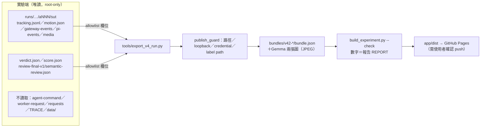

# V4.2 Demo 網站改版：計畫與決策紀錄（2026-10-15）

## 背景

公開網站原本是已封存的舊 ISR agent（sweep/inspect 架構，沒有 detector／tracker）。V4.2 已經換成 YOLO26s＋ByteTrack、motion fact index、target crop，並有 Runtime Verifier 和 Post-hoc Verifier。這次改版把網站換成 V4.2 的六片結果，重新設計 detector／tracker 的視覺化，並新增 Architecture 頁。

## 決策

| # | 決策 | 理由 |
|---|---|---|
| D1 | 舊的 12 個 runs 從網站移除，保留在 git tag `legacy-isr-agent-site` | 舊系統的架構不同，兩套 bundle 格式並存會增加維護成本 |
| D2 | 發佈 V4.2 batch `20261015-06-eval-6-v4.2-direction-first` 全部六片，a002（`1-nominal-r1`）設為 featured | 使用者決定發佈全部六片；只放最好的一片會造成選擇性呈現 |
| D3 | 顯示 GT 和 study scorer，並標註「after the run／agent 從未看到」 | 這六片的 GT 自 2026-09-14 起已公開；影片 sha256 與 V4.2 run 一致 |
| D4 | 網站只有兩頁：Run replay 和 How it works；不做 live | 使用者指示 live 先不做；舊的單頁限制改成兩頁 |
| D5 | 架構圖用 React＋SVG 自繪，不加 mermaid 依賴 | 需要配合主題配色、和逐步播放連動，並保持手機可讀 |
| D6 | 實驗端一律唯讀；只修改 `demos/isr-video-agent-demo/` 和 `demos/README.md` | 系統和 trace 仍在開發中 |

## 資料邊界

| 公開 | 不公開 |
|---|---|
| detection／prediction 框、track alias、movement phases、tool calls 和 host 回覆文字、Gemma 實際收到的兩張圖和回答、提交答案、兩個 Verifier 的結果、scorer 的 allowlist 欄位、commit hash | 原始 requests（含 base64 和完整 messages）、agent command／環境變數、路徑、service token 路徑、review 截圖、來源影片原檔、labels |

## 頁面設計

### Run replay

| Panel | 內容 | 跟 run clock 的關係 |
|---|---|---|
| Batch line＋六張 run 卡片 | 6/6 accepted、3/6、1/6、0/6、未 promote；每片的回答 | 固定顯示 |
| Casenote | 每片的誠實說明，依據報告第 3–5 節 | 固定顯示 |
| VideoPanel | Detections、Track trails、Movement 箭頭、Kalman predictions（預設關）、GT（預設關）、TARGET→Gemma 框；可切換到「What Gemma saw」 | `scan_video` 回傳之前不顯示任何 detection |
| TrackTimeline | 每個 track 一列，依方向上色；◆ 標出送給 Gemma 的 frame；可疊加 GT 區間 | 同上 |
| TrackInventory | agent 收到的 track facts、re-read 次數、Gemma 原文 | 同上 |
| Perception | 每次 Gemma 呼叫的 full 圖＋crop＋原文 | 該 call 回傳後才顯示 |
| Budgets／Steps | 18 次 tool call；連續的 observation_get 合併顯示（re-reads, no new information） | 逐步顯示 |
| Verdict | Answer、Runtime Verifier、Post-hoc Verifier、Study scorer 四塊分開 | 提交之後才顯示 |

### How it works

1. 元件和信任邊界：分區卡片，加上「每個邊界傳遞什麼」的表格。
2. a002 的實際 call sequence（17 步，可逐步播放，可跳回 replay 的對應時間點）。
3. 資料流：每個階段的 payload 都用 a002 的實際值。
4. Detector／tracker 四格圖解：取 frame 30 的實際資料，依序是 detect、associate、trajectories、movement。
5. 版本演進：舊網站系統 → V4.0 → V4.1 → V4.2。
6. 模型和 revision。

## 驗證結果（2026-10-15）

| 項目 | 結果 |
|---|---|
| `validate_bundle.py` | 6/6 pass |
| `build_experiment.py --check` | 數字與報告一致 |
| `npm run build` | 通過（tsc＋vite） |
| 瀏覽器（Chromium headless） | t=2s 時 0 個 detection、結尾時 3 個；T3@43 的 TARGET 框和紫車對齊；GT／track 選取／timeline 連動正常；a005 有 8 張 Gemma 卡；Architecture 跳回 replay 時 t=13.3s；400px 寬、淺色和深色主題都沒有橫向溢出；主控台 0 錯誤 |
| 實驗端未被修改 | 前後比對 `video-agent`／study 的 HEAD 和 status，以及 batch 目錄所有檔案的 sha256 |
| 權限 | `agent_user.sh --check` 結果，見 commit 說明 |

## 未做和限制

- Live demo 沒有移植。
- 網站只呈現已實作的 runtime 和這一次測量，不代表 V4.2 達標。
- 每片的說明文字依據 coding-agent 的核讀，不是獨立盲評。
