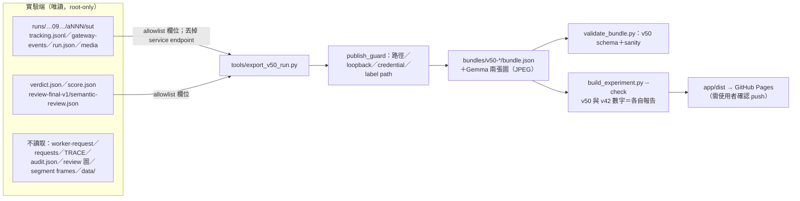

# V5.0 Demo 網站改版：計畫與決策紀錄（2026-10-15）

## 背景

網站原本只有 V4.2。V5.0 改成**程式主導**：

1. host 做 tracking。
2. 把 T 保守地組成 V。
3. 用固定交通規則找出逆向候選。
4. host 自己選 frame 問 Gemma 顏色。
5. 由 assembler 組出答案。

Pi＋Nemotron 只在出現「調查案件」時才會啟動，這六片都沒有觸發，所以 Nemotron 呼叫次數是 0。

這次改版的內容：
- 網站改成以 V5.0 為主，V4.2 保留為 previous 版本。
- 新增 V5.0 的 Run replay 和 Architecture 頁。

來源：
- batch `20261015-09-eval-6-v5.0-program-first`
- SUT `5ff6b8a`
- study `47e7d83`
- 報告 `sut-v5.0-six-video-20261015.zh-TW.md`

## 決策

| # | 決策 | 理由 |
|---|---|---|
| D1 | V5.0 為主，V4.2 保留，用版本切換 | 使用者決定。V5.0 六片都沒有 agent 呼叫；保留 V4.2 才看得到 LLM agent 的行為 |
| D2 | V5.0 featured 為 a002（`1-nominal-r1`） | 使用者決定。和 V4.2 同一片，方便對照；可看到 T1＋T3→V1 和 T8＋T9→V8 |
| D3 | V5.0 replay 用 pipeline stage stepper，不用 run clock | V5.0 沒有 agent 步驟。各階段只有 tracking 和 Gemma 有 latency 紀錄，其他 host 計算沒有分段時間戳 |
| D4 | 調查分支（Pi＋Nemotron）一律畫成虛線，標「implemented, not exercised live」 | 報告明寫本輪 live 未驗證，只在 fake-provider 工程測試通過 |
| D5 | V5.0 batch line 列出 6/6 count、6/6 supported、4/6 exact、**0/6 complete**、0 Nemotron、未 promote | 依報告 §1；不讓數量全對看起來像任務已完成 |
| D6 | Source review 卡獨立，標「coding agent, not blind」 | semantic-review.json 自述非獨立盲評 |
| D7 | 架構圖元件（ComponentMap／Sequence／DataFlow）改成吃 props，兩個版本共用；內容分在 `v42/content.ts`、`v50/content.ts` | 避免複製兩套圖元件；內容各自依版本來源 |
| D8 | 未知 bundle（例如舊網站的 `#/run/fd-pi-…`）轉到 V5.0 featured，並顯示一行提示 | 先前使用者回報空白頁；舊連結不應落在錯誤訊息上 |
| D9 | 修改前打 tag `v42-site`，指向 `31a0232` | 保留只有 V4.2 的版本 |
| D11 | Architecture 第 2 節的 sequence 畫一般流程，不畫 a002 的 trace（2026-10-16） | 使用者要求：這張圖應描述架構，不是某次 trace。實際數值留在第 3 節資料流和 replay |
| D10 | 實驗端一律唯讀；只修改 `demos/isr-video-agent-demo/` 和 `demos/README.md` | 系統和 trace 仍在開發中 |

## 資料邊界

**V5 bundle 公開的內容**
- 每個 frame 的 detection 框，帶 T index 和 V index；V5 bundle 不帶 detector confidence。
- Kalman predictions。
- V records：members、phases、opposing、vote、flow、support 數。
- links 和 possible links，含幾何證據。
- Gemma 實際看到的兩張圖、原文和解析出的顏色。
- host 答案、兩個 Verifier 的結果、scorer 的 allowlist 欄位、source review 的該片條目。
- commit hash。

**Exporter 自我檢查**
- 每個 V 的 members 必須等於從框推得的 T 集合。T alias 依 raw tracker id 排序，與 `store/motion_v41.MotionIndex` 一致。
- ungrouped 數量必須等於答案的 `ungrouped_detection_count`。
- Gemma 呼叫數必須等於 budget 紀錄。

## 頁面設計

### Run replay（V5.0）

| Panel | 內容 | 跟 stage 的關係 |
|---|---|---|
| 版本切換、batch line、六張卡、casenote | V5.0／V4.2 切換時保留同一片 | 固定顯示 |
| Pipeline stepper | ① Track ② Group ③ Traffic rule ④ Look ⑤ Assemble ⑥ Verify。顯示 wall／tracking／Gemma 時間；旁邊放虛線的 Investigation 框 | `?stage=0–6`，預設 6 |
| VideoPanel | stage 1：依 T 上色；stage ≥2：依 V 上色（標籤 `V·T`），ungrouped 畫灰虛線；stage ≥3：逆向 phase 標成 TARGET 色；stage ≥4：TARGET 框；可切到「What Gemma saw」 | 同左 |
| Vehicle timeline | 每個 V 一列，依方向上色，標出 member T；◇ 是 join，附證據 tooltip；≈ 是 possible link；底部加 ungrouped 密度條；◆ 標 Gemma frame；括號標回報區間；可疊 GT | stage 1 時顯示 T 列 |
| Traffic rule | 羅盤畫出 votes、flow、135° 楔形、選定車的 phases；附表格 | stage ≥3 |
| Grouping | joins、possible links、unmatched→attached／ungrouped 的數量 | stage ≥2 |
| Perception | host 選定的 V→T@frame、兩張圖、原文、parsed color | stage ≥4 |
| Answer | Host answer（stage ≥5）；Runtime Verifier、Post-hoc Verifier、Study scorer、Source review 四張卡分開（stage 6） | 同左 |
| Budgets | Nemotron 0/20、Gemma n/12、tool text 0；調查分支說明和五個 tools（未使用） | Gemma 計數隨 stage 變化 |

### How it works（V5.0，`#/architecture`；V4.2 在 `#/architecture/v4.2`）

1. 元件和信任邊界。agent 區和 Nemotron 畫虛線。
2. 一般的 call sequence（19 步，2026-10-16 改，依 SUT `v5.0.zh-TW.md` 的 canonical 視圖），不綁定特定 trace：host 內部步驟畫成自迴圈；每個候選重複的 Gemma 呼叫用 `loop` 框；調查分支用紅色虛線 `opt` 框，標「not exercised live」，內含每案件最多兩次 Gemma 的巢狀 `opt`。主流程的步驟可以跳到 featured replay 的對應 stage。
3. 資料流，使用 a002 的實際值：18 T、116 unmatched、14 V、82 ungrouped、13 votes、V1 152°、purple。
4. 四格圖解：tracker IDs → vehicle records → one vote each → against the flow。
5. V4.2 → V5.0 對照（報告 §8，描述性對照，不是因果實驗），以及各版本演進表。
6. 模型和 revision。

## 驗證結果（2026-10-15）

| 項目 | 結果 |
|---|---|
| V4.2 exporter 抽出共用 helper 之後 | 六個 bundle 和圖檔除了 `exported_at` 以外完全相同；最後沒有重寫 V4.2 bundle |
| `validate_bundle.py` | 12/12 pass。以人工突變測試（錯區間、錯 ungrouped 數、loopback 字串）確認三種錯誤都會被擋下 |
| `build_experiment.py --check` | v50 和 v42 的數字都和報告一致 |
| `npm run build` | 通過 |
| 瀏覽器（Chromium headless） | stage 0 時 0 個框；stage 1 標籤是 T、stage 2 標籤是 V·T；frame 43 的 TARGET V1·T3；ungrouped 82；V1 152° 落在楔形內；a003 V7 區間 57–59、59–84、86–88；a005 V8 unresolved；a001 沒有 Gemma；a006 雙色原文；版本切換到 V4.2 後原本功能正常；舊連結會轉址；Architecture 跳回 stage 3；400px 寬、淺色和深色都沒有溢出；console 0 錯誤 |
| 實驗端未被修改 | 兩個 repo 的 HEAD、status，以及兩個 batch 所有檔案的 sha256，前後比對相同 |
| 權限 | `agent_user.sh --check` 的結果見 commit 說明 |

## 未做和限制

- Live demo 沒有移植。
- V5.0 調查分支沒有 live 資料可以呈現，網站只說明它的設計和限制。
- 各 pipeline stage 只有 tracking 和 Gemma 有時間紀錄，stepper 不假裝有更細的時間軸。
- Casenote 依據報告和 coding-agent 核讀，不是獨立盲評。
